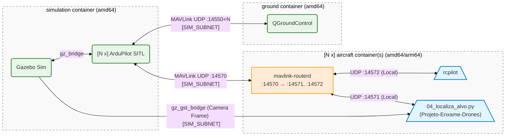
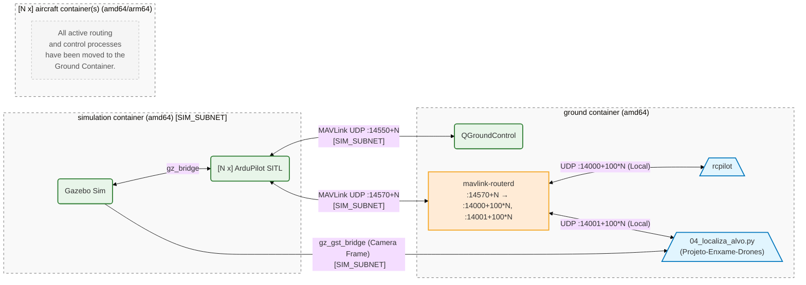

# aerial-autonomy-stack

*Aerial autonomy stack* (AAS) is an all-in-one software stack to:

1. **Develop** multi-drone autonomy—with ROS2 and ArduPilot
2. **Simulate** faster-than-real-time perception and control—with YOLOv8
3. **Deploy** in real drones—with JetPack and NVIDIA Orin

<details>
<summary><b>Feature list</b> <i>(click to expand)</i></summary>

- **ArduPilot multi-vehicle** simulation (**quadrotors and VTOLs**)
- **YOLOv8** (with ONNX GPU Runtimes)
- 3D worlds for perception-based simulation
- **Steppable** [Gymnasium environment](https://gymnasium.farama.org/index.html) and **faster-than-real-time**, **multi-instance** simulation
- Gazebo's wind effects plugin
- **Dockerized simulation** based on [`nvcr.io/nvidia/cuda:12.8.1-cudnn-runtime-ubuntu22.04`](https://catalog.ngc.nvidia.com/orgs/nvidia/containers/cuda/tags)
- **Windows 11** compatibility *via* WSLg
- Multi-**Jetson-in-the-loop simulation** (`JETSON=true`) to test NVIDIA- and ARM-based on-board compute
- Dual network to separate simulated sensors (`SIM_SUBNET`) and inter-vehicle comms (`AIR_SUBNET`)
- [ArduPilot Guided](https://ardupilot.org/copter/docs/ac2_guidedmode.html) interface (i.e. `setpoint_velocity`, `setpoint_accel` references)
- Logs analysis with MAVExplorer (`.bin`)

</details>

https://github.com/user-attachments/assets/57e5bc91-8bee-4bae-8f81-a9aacef471e7

## Overview

### 1. Decentralized Mode (`CENTRALIZED=false`)

### 2. Centralized Mode (`CENTRALIZED=true`)


<details>
<summary>Repository Structure <i>(click to expand)</i></summary>

```sh
aerial-autonomy-stack
│
├── aas-gym
│   └── src
│       └── aas_gym
│           └── aas_env.py                          # aerial-autonomy-stack as a Gymnasium environment
│
├── aircraft
│   ├── aircraft_resources                          # Aircraft scripts, patches, and models
│   └── aircraft.yml.erb                            # Aircraft docker tmux entrypoint
│
├── ground
│   ├── ground_resources                            # Ground scripts and patches
│   └── ground.yml.erb                              # Ground docker tmux entrypoint
│
├── scripts
│   ├── docker
│   │   ├── Dockerfile.aircraft                     # Docker image for aircraft simulation and deployment
│   │   ├── Dockerfile.rc_aircraft                  # Aircraft image with rcpilot and OpenVINS (used when RCPILOT=true)
│   │   ├── Dockerfile.ground                       # Docker image for ground system simulation and deployment
│   │   ├── Dockerfile.rc_ground                    # Ground image with rcpilot (used when RCPILOT=true)
│   │   └── Dockerfile.simulation                   # Docker image for SITL simulation
│   │
│   ├── gym_run.py                                  # Examples for the Gymnasium aas-gym package
│   │
│   ├── sim_build.sh                                # Build all dockerfiles for amd64/simulation
│   └── sim_run.sh                                  # Start the simulation (SITL, or Jetson-in-the-loop with JETSON=true)
│
└── simulation
    ├── simulation_resources
    │   ├── aircraft
    │   │   ├── vehicles                            # ArduPilot quad (iris_with_ardupilot) and VTOL (alti_transition_quad) models
    │   │   ├── sensors                             # Camera models (d435 RGB-D, sensor_thermal_camera)
    │   │   └── payloads                            # Droppable payload models (grenade, fog_generator)
    │   ├── worlds                                  # Gazebo world files (<world>.sdf)
    │   ├── world_models                            # Models included by the world files
    │   ├── objects                                 # Models that can be placed as custom objects
    │   ├── scenarios                               # Scenario files: world, vehicles, and custom objects
    │   └── scripts                                 # World generation and simulation helper scripts
    │
    └── simulation.yml.erb                          # Simulation docker tmux entrypoint
```
</details>

## Installation

> AAS is tested on Ubuntu 22.04/24.04 with `nvidia-driver-580` using an i7-11 with 16GB RAM and RTX 3060
> 
> On Ubuntu, read [`REQUIREMENTS_UBUNTU.md`](/supplementary/REQUIREMENTS_UBUNTU.md) to setup the requirements (Docker Engine, `nvidia-ctk`)
>
> On Windows 11, read [`REQUIREMENTS_WSL.md`](/supplementary/REQUIREMENTS_WSL.md) to setup WSLg and the requirements

```sh
sudo apt update && sudo apt install -y git git-lfs && git lfs install
sudo apt install -y xterm xfonts-base # Only needed on WSL or with TERMINAL=xterm (GNOME Terminal is used by default on Ubuntu)

git clone https://github.com/droneswarmufpe/aerial-autonomy-stack.git
cd aerial-autonomy-stack/scripts/

./sim_build.sh
# Note: the 1st build takes ~30GB of space and ~25' with good internet (`Ctrl + c` and restart if needed)
```

## Simulation


> On a low-mid range laptop—i7-11 with 16GB RAM and RTX 3060—AAS can simulate faster than real time with flag `RTF=0.0` (ArduPilot SITL speedup is capped at **10x**). Run multiple `sim_run.sh` in parallel adding flag `INSTANCE=1`, `INSTANCE=2`, etc. for even higher throughput. On native Linux, `sim_run.sh` selects NVIDIA for Gazebo rendering using PRIME render offload. `RTF` sets a target; Gazebo displays the measured speed (100% = real time, 300% = 3×), which depends on the active cameras and other processing.

```sh
# Start AAS with a scenario (centralized mode)
cd aerial-autonomy-stack/scripts
SCENARIO=imav_hotspots CENTRALIZED=true EVAAT=false RTF=3.0 ./sim_run.sh
```

```sh
# Start AAS with the ESEFEX scenario, one drone, and the EVAAT GCS
cd aerial-autonomy-stack/scripts
SCENARIO=esefex_fbx CENTRALIZED=false EVAAT=true RTF=3.0 ./sim_run.sh
```

### Scenarios

A scenario is a JSON file that sets the world, the quads and VTOLs (each with its own cameras and pose), and the custom objects. `SCENARIO` is a file name in [`simulation/simulation_resources/scenarios/`](/simulation/simulation_resources/scenarios) (without `.json`) or a path to any `.json` file; it defaults to `default` (`esefex_fbx` with one quad). The `scenarios/` and `world_models/` folders are mounted into the simulation container, so scenarios and worlds can be added or edited from the host without an image rebuild; changes apply on the next run.

```json
{
  "world": "imav",
  "quads": [
    {"x": 0, "y": 0, "yaw": 90},
    {"x": 3, "y": 0, "rgbd_camera": false, "thermal_camera": true},
    {"global_position": {"lat": 48.80255, "lon": 7.85420, "alt": 1}}
  ],
  "vtols": [
    {"x": 0, "y": 4, "camera": false}
  ],
  "custom_objects": [
    {"id": 1, "model": "construction_cone", "global_position": {"lat": 48.810124, "lon": 7.853343, "alt": 4}},
    {"id": 2, "model": "ime-target", "local_position": {"x": 15, "y": -25, "z": 0}, "attitude": {"roll": 0, "pitch": 0, "yaw": 45}, "static": true}
  ]
}
```

- `world`: a world file in [`worlds/`](/simulation/simulation_resources/worlds) (without `.sdf`)
- `quads` / `vtols`: one entry per vehicle. Drone IDs follow the list order, quads first: `iris_with_ardupilot_1`, `iris_with_ardupilot_2`, ..., then the VTOLs

| Vehicle field | Default | Description |
| --- | --- | --- |
| `x`, `y` | required, or `global_position` | Spawn position in meters (world frame) |
| `global_position` | — | Spawn position as `lat`/`lon` (and optionally `alt`, used as `z`), converted with the world's `<spherical_coordinates>` origin |
| `z` | `0.75` | Spawn height in meters |
| `yaw` | `0` | Spawn heading in degrees |
| `camera` | `true` | Master camera switch: `false` disables all cameras |
| `rgbd_camera` | `true` | Master switch for the four D435 sensors below |
| `rgb_camera` | `true` | D435 RGB color sensor and stream |
| `infrared_1_camera` | `true` | D435 left infrared sensor and stream |
| `infrared_2_camera` | `true` | D435 right infrared sensor and stream |
| `depth_camera` | `true` | D435 depth sensor and stream |
| `thermal_camera` | `false` | Thermal camera stream |
| `camera_pitch` | `1.5707` | Camera pitch in radians (90 deg down) |
| `sitl_ground_truth` | `false` | Enable ground-truth estimator, direct simulated GPS, and one simulated IMU together |
| `vio_bridge` | `false` | Stereo VIO (quads only), see below |

Set these fields on each vehicle in the scenario JSON. [`esefex_fbx.json`](/simulation/simulation_resources/scenarios/esefex_fbx.json) lists its camera settings explicitly. Omitted fields keep their defaults. Camera changes apply on the next run of `sim_run.sh`, without an image rebuild.

- `custom_objects`: models from [`objects/`](/simulation/simulation_resources/objects) (or [`world_models/`](/simulation/simulation_resources/world_models)), each with a `global_position` (lat/lon/alt, converted with the world's `<spherical_coordinates>` origin) or a `local_position` (x/y/z), and optionally an `attitude` (roll/pitch/yaw in degrees) and `static` (default `false`)

`NUM_QUADS` and `NUM_VTOLS` spawn only the first N quads/VTOLs of the scenario (all of them by default). `sim_run.sh` validates the scenario before starting any container. Full reference, including the available scenarios: [supplementary/SCENARIOS.md](/supplementary/SCENARIOS.md); custom objects: [supplementary/CUSTOM_OBJECTS.md](/supplementary/CUSTOM_OBJECTS.md).

```sh
SCENARIO=esefex_targets_1 ./sim_run.sh                          # A scenario in scenarios/
SCENARIO=/path/to/my_scenario.json NUM_QUADS=1 ./sim_run.sh     # Any scenario file, only its first quad
python3 ../simulation/simulation_resources/scripts/scenario.py imav_hotspots   # Validate and print a resolved scenario
```

Gazebo derives the D435 infrared and depth image topics from each model's
world/model path, so all four RGB-D streams are distinct for every drone.
Infrared and depth run at 30 Hz.

### Stereo VIO (ArduPilot Iris)

Set `"sitl_ground_truth": true` per vehicle in the scenario JSON to enable simulator ground truth (`AHRS_EKF_TYPE=10`), direct simulated GPS (`GPS1_TYPE=100`), and one simulated IMU (`SIM_IMU_COUNT=1`) together. If absent or false, the vehicle's normal EKF, GPS, and IMU defaults apply. This flag is independent of `vio_bridge` and only affects generated SITL parameters; arming checks remain enabled. See [SITL estimator](/supplementary/SCENARIOS.md#sitl-estimator).

Build the simulation and RC aircraft images after changing the VIO bridge or
startup templates, then enable the opt-in path:

```sh
cd scripts
CONTAINER=simulation ./sim_build.sh
CONTAINER=rc_aircraft ./sim_build.sh
SCENARIO=calibration_vio RCPILOT=true RTF=1 ./sim_run.sh
```

`"vio_bridge": true` is set per quad in the scenario and requires `camera` and
`rgbd_camera` and both `infrared_1_camera` and `infrared_2_camera` on that quad,
`RCPILOT=true`, and `JETSON=false`. It starts OpenVINS
in that quad's aircraft container and sends its sensor topics in its ROS domain
(`ROS_DOMAIN_ID=DRONE_ID`). VIO stays in the aircraft container even when
`CENTRALIZED=true`. Quads without `vio_bridge` keep the existing video-stream path.

| Topic in each aircraft's ROS domain | Data |
| --- | --- |
| `/camera/infra1/image_raw` | Left `mono8`, 1280×720, 30 Hz simulation time |
| `/camera/infra2/image_raw` | Right `mono8`, 1280×720, 30 Hz simulation time |
| `/vio/imu` | Original Gazebo IMU feeding the ArduPilot plugin |
| `/clock` | Gazebo simulation time |

The [D435 stereo baseline](https://dev.realsenseai.com/docs/high-speed-capture-mode-of-intel-realsense-depth-camera-d435/)
is 50 mm, with infra1 on the left. The renderer uses
`RGB_INT8` to avoid the expensive Ogre2 L8 readback path; `vio_bridge` converts to
grayscale before ROS publication. IR H.264 streams are disabled in VIO mode.
The bridge publishes only pairs whose original Gazebo capture stamps match
exactly; mismatched frames are dropped from a bounded cache, never retimestamped
to manufacture a pair. ROS delivery is not atomic, so consumers still synchronize
using those stamps. This models ideal instantaneous global-shutter stereo with
Gaussian image noise. It does not model near-IR material response, exposure blur,
the dot projector, or physical RealSense image processing.

OpenVINS calibration is generated at aircraft startup in `/tmp/aas_vio/` from
the same host-mounted D435 and Iris SDFs used by the simulation. It includes the
camera mount, the quad's `camera_pitch`, sensor offsets, optical-axis rotation, and the
plugin IMU's 180-degree roll (FRD frame). Intrinsics come from resolution and
horizontal FOV (`fx=fy≈695.995`, `cx=640`, `cy=360`), distortion and camera/IMU
time offset are zero. Calibration estimation is disabled for this known geometry.
Gravity magnitude is 9.8 m/s², matching the current AAS worlds; update the
generator if using a custom world with different gravity.
The old external checkout's `gazebo_ros2` calibration is not used; its estimator
settings serve as a template. Current support is limited to the rigid Iris SDF
hierarchy, not arbitrary SDF `relative_to` frame graphs.

The direct IMU path preserves acquisition timestamps in the same clock as the
cameras. It uses the **same sensor that feeds SITL**, without adding another IMU
or changing ArduPilot's sensor settings. Its 1000 Hz requested update rate is
limited to approximately 500 Hz by the generated world's 2 ms physics step.
There is no 200 Hz decimation. This IMU has no injected noise; the small nonzero
noise values in the generated estimator config are filter tuning values.

200 Hz `HIGHRES_IMU` traffic between containers is inexpensive, but Copter 4.6.2
constructs its timestamp from `AP_HAL::micros64()` when sending the current
filtered IMU values. It does not carry the original Gazebo sample timestamp.
Using that path requires validating clock alignment and filter/sample latency;
this VIO mode therefore bypasses MAVLink for IMU delivery. Do not also publish a
MAVLink IMU on `/vio/imu`.

Start with `RTF=1` when evaluating estimator performance. At accelerated RTF,
sensor rates scale in wall time and OpenVINS must keep up. Restart OpenVINS after
a simulation time reset. This mode starts the estimator only; it does not feed
its odometry back into the flight controller.

Centralized mode streams all aircraft data (including MAVLink) to the ground container, so the stack runs as external processing rather than onboard. Set `CENTRALIZED=false` to keep streams local to each aircraft container.

In the `Simulation`'s Xterm terminal:
```sh
# 2. Analyze
/aas/simulation_resources/scripts/plot_logs.sh                                                # Analyze the flight logs at http://10.42.90.100:5006/browse or in MAVExplorer
```

Full parameter list: [supplementary/DOCKER_PARAMS.md](/supplementary/DOCKER_PARAMS.md)

Optionally, add or disable **wind effects**, in the `Simulation`'s Xterm terminal:

```sh
python3 /aas/simulation_resources/scripts/gz_wind.py --from_west 0.0 --from_south 3.0
python3 /aas/simulation_resources/scripts/gz_wind.py --stop_wind
```

> [!TIP]
> </details>
> <details>
> <summary>Tip 1: use <b>Tmux shortcuts</b> to navigate windows and panes in Xterm <i>(click to expand)</i></summary>
>
> ```sh
> Ctrl + b, then n, p                   # Move between Tmux windows 
> Ctrl + b, then [arrow keys]           # Move between Tmux panes in a window
> Ctrl + [, then [arrow keys]           # Enter copy mode (to select and/or scroll back)
> q                                     # Exit copy mode
> Ctrl + b, then "                      # Split a Tmux window horizontally
> Ctrl + b, then %                      # Split a Tmux window vertically
> Ctrl + b, then d                      # Detach Tmux
> ```
> ```sh
> tmux list-sessions                    # List all sessions
> tmux attach-session -t [session_name] # Reattach a session
> tmux kill-session -t [session_name]   # Kill a session
> tmux kill-server                      # Kill all sessions
> ```
> </details>
> <details>
> <summary>Tip 2: periodically run <b>Docker cleanups</b> <i>(click to expand)</i></summary>
>
> ```sh
> docker ps -a                          # List containers
> docker stop $(docker ps -q)           # Stop all containers
> docker container prune -f             # Remove all stopped containers
> ```
> ```sh
> docker network ls                     # List docker networks
> docker network rm <network_name>      # Remove a specific network
> docker network prune -f               # Remove all unused networks
> docker system prune                   # Remove stopped containers, unused networks and cache, dangling images
> ```
> ```sh
> docker images                         # List images
> docker image prune                    # Remove untagged images
> docker rmi <image_name_or_id>         # Remove a specific image
> docker builder prune                  # Clear the cache system-wide
> ```
> </details>


### Available worlds

- `apple_orchard` — a GIS world created using [BlenderGIS](https://github.com/domlysz/BlenderGIS)
- `betione` — custom world
- `calibration_vio` — calibration world for the stereo VIO
- `cbr_phase1`, `cbr_phase2` — RoboCup field worlds
- `esefex_fbx` — RJ military base
- `imav` — custom world
- `impalpable_greyness` — an empty world with simple shapes
- `jockey` — custom world
- `shibuya_crossing` — a 3D world adapted from [cgtrader](https://www.cgtrader.com/)
- `swiss_town` — a photogrammetry world courtesy of [Pix4D / pix4d.com](https://support.pix4d.com/hc/en-us/articles/360000235126)

### Available objects

Models in `objects/` that scenarios can place as custom objects:

- `Robocup4`
- `arquus_vt4`
- `aruco_5x5_0`
- `construction_cone`
- `human_dummy`
- `ime-target`
- `panhard_vbl`
- `renault_ccfm_a`
- `renault_ccfm_b`
- `renault_ccfm_c`
- `renault_gbc180`
- `rescue_randy`
- `toyota_hilux`
- `vltt_a`

## License 

Distributed under the MIT License. See `LICENSE.txt` for more information. Copyright (c) 2025 Jacopo Panerati

## Known Issues

- ArduPilot SITL for Iris uses option -f that also sets "external": True, this is not the case for the Alti Transition from ArduPilot/SITL_Models
- QGC is started with a virtual joystick (with low throttle if using only VTOLs and centered throttle if there are quads), this is reflective of real-life but note that this counts as "RC loss" when switching focus from one autopilot instance to another
- Command 178 MAV_CMD_DO_CHANGE_SPEED is accepted but not effective in changing speed for ArduPilot VTOL
- In ArdupilotInterface's action callbacks, std::shared_lock<std::shared_mutex> lock(node_data_mutex_); could be used on the reads of lat_, lon_, alt_

