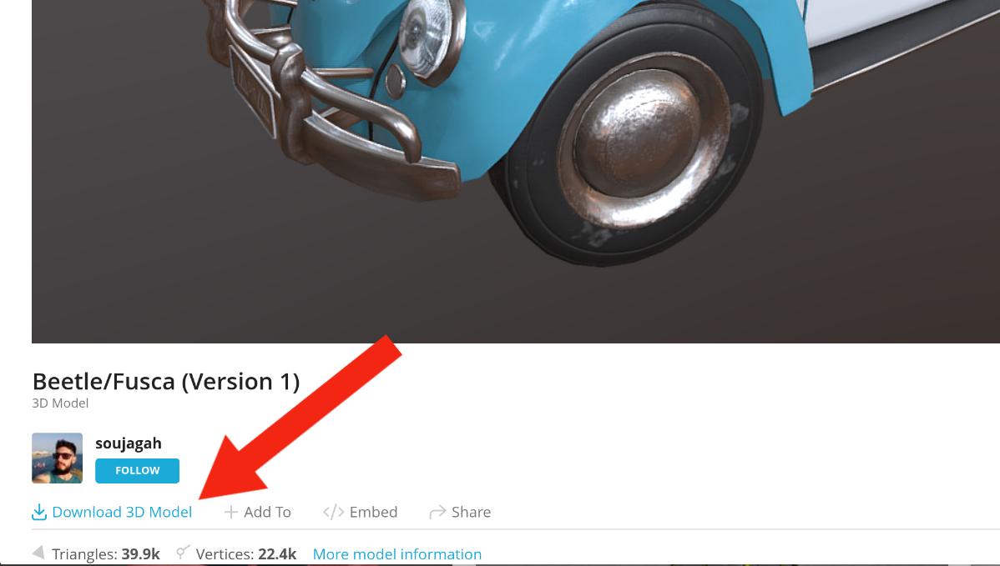
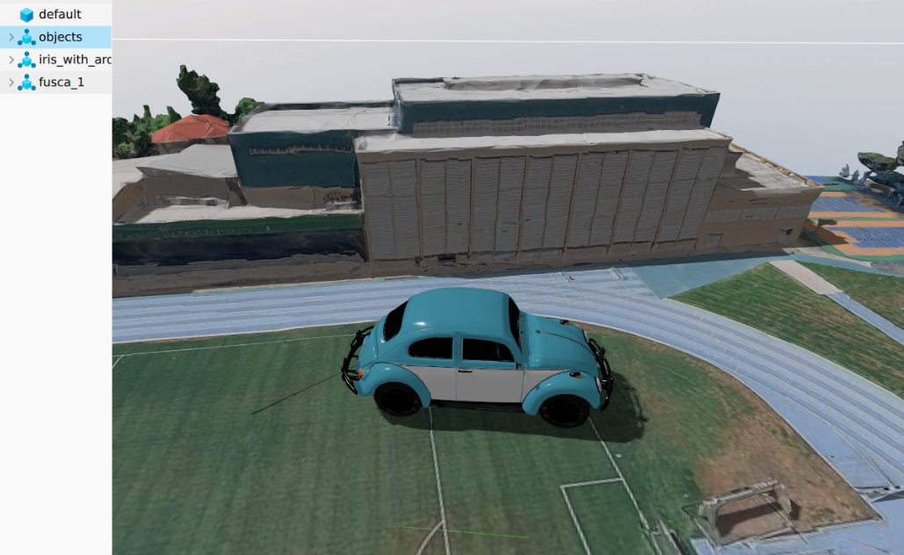

# Escolhendo o modelo
> [!NOTE]
>Caso já tenha o arquivo correspondente ao modelo baixado e pronto para ser adicionado, esse tópico é dispensável.

- Primeiramente, é necessário encontrar o modelo que será adicionado ao mundo. Para isso, existem diversos sites de repositórios de modelos 3D. Um dos mais populares é o [*Sketchfab*](https://sketchfab.com/feed).
- Antes de acessar os modelos 3D, é preciso logar na plataforma para ter permissão de baixá-los usando a opção de "**LOGIN**". Caso não tenha uma conta, ela pode ser rapidamente criada a partir da opção de "**SIGN UP**". 


<div align="center">
  
</div>

- Após o login efetuado com sucesso, será aberto o feed do *Sketchfab* onde será possível pesquisar pelo modelo desejado na barra de busca no canto superior da tela.

<div align="center">
  
</div>

- Após selecionar o modelo desejado, será aberta a página correspondente a ele. Para baixá-lo, é preciso certificar-se que o modelo está disponível para *download*, como mostra a opção abaixo.

<div align="center">
  
</div>

> [!NOTE]
Caso essa opção não apareça, então o dono do modelo não autoriza o seu *download*. Portanto, é recomendado procurar outro modelo semelhante.

- Ao clicar na opção de "**Download 3D Model**", será aberta uma janela com vários formatos de modelo 3D que podem ser baixados.

<div align="center">
  
</div>

- É recomendado baixar apenas modelos **.fbx** ou **.glb**, pois eles foram os mais testados e possuem garantia de funcionamento. Entretando, o Gazebo também suporta modelos **.dae**, **.stl** e **.obj**.
- Ao clicar em "**DOWNLOAD**", o modelo no formato escolhido será baixado e estará pronto para ser adicionado ao mundo da simulação.

# Adicionando o modelo ao mundo

## Adicionando o modelo ao repositório
- Com o arquivo do modelo pronto, será necessário criar uma pasta para ele em `simulation/simulation_resources/objects/`. Logo, partindo da raíz do repositório:
```bash
mkdir simulation/simulation_resources/objects/<nome-do-modelo>
```
- Dentro da pasta criada, é preciso criar dois arquivos `model.sdf` e `model.config`.
    - O formato deles é padronizado entre os modelos usados na simulação, sendo necessário apenas modificar as informações específicas do modelo que está sedo adicionado.
    - Template do `model.config`
    ```xml
    <?xml version="1.0"?>
    <model>
        <name>NOME DO MODELO</name>
        <version>1.0</version>
        <sdf version='1.10'>model.sdf</sdf>

        <author>
            <name>NOME DO AUTOR</name>
            <email>EMAIL DO AUTOR</email>
        </author>

        <description>
            DESCRICAO DO MODELO
        </description>
    </model>
    ```
    > [!NOTE]
    Os campos dentro da tag `<author>` não são obrigatórios, podendo ficar vazios, apesar de ser boa prática preenchê-los.

    - Template do `model.sdf`
    ```xml
    <?xml version="1.0"?>
        <sdf version='1.10'>
        <model name='NOME_DO_MODELO'>
        <pose>0 0 0 0 0 0</pose>
            <link name='base_link'>
            <pose>0 0 0 0 0 0</pose>
            <inertial>
                <pose>0 0 0 0 0 0</pose>
                <mass>100</mass>
                <inertia>
                <ixx>1</ixx>
                <iyy>1</iyy>
                <izz>1</izz>
                </inertia>
            </inertial>
            <collision name='base_link_collision'>
                <pose degrees="true">0 0 0 0 0 0</pose>
                <geometry>
                <box>
                    <size>1.0 1.0 1.0</size>
                </box>
                </geometry>
            </collision>
            <visual name='base_link_visual'>
                <pose degrees="true">0 0 0 0 0 0</pose>
                <geometry>
                <mesh>
                    <scale>1.0 1.0 1.0</scale>
                    <uri>model://PASTA-DO-MODELO/meshes/ARQUIVO-DO-MODELO</uri>
                </mesh>
                </geometry>
            </visual>
            </link>
        </model>
    </sdf>
    ```
    > [!NOTE]
    É recomendado que a pasta do modelo e o arquivo do modelo baixado tenham o mesmo nome para evitar confusões.
- Após isso, é preciso criar uma pasta chamada `meshes` dentro da mesma pasta do modelo que foi criada e onde foram adicionados os arquivos anteriormente.
```bash
mkdir simulation/simulation_resources/objects/<nome-do-modelo>/meshes
```
- Após a criação da pasta, adicione nela o arquivo **.glb** ou **.fbx** baixado anteriormente.

>[!NOTE]
> A pasta `objects/` é montada a partir do seu computador no container de simulação, então um modelo novo pode ser usado na próxima execução, sem precisar reconstruir a imagem `simulation-image`.

# Adicionando o objeto a um cenário
Os objetos customizados fazem parte de um cenário: um arquivo .json em `simulation/simulation_resources/scenarios/` que define o mundo, os drones e os objetos de uma simulação. O formato completo dos cenários está descrito em [`SCENARIOS.md`](SCENARIOS.md).

- No arquivo do cenário, adicione um objeto à lista `custom_objects`. Para colocar mais de um objeto do mesmo modelo, basta adicionar um elemento para cada um.

```json
{
  "world": "imav",
  "quads": [{"x": 0, "y": 0}],
  "custom_objects": [
    {
      "id": 1,
      "model": "panhard_vbl",
      "local_position": {"x": -16.8706, "y": -0.9578, "z": 4.0},
      "static": false
    },
    {
      "id": 2,
      "model": "construction_cone",
      "global_position": {"lat": 48.810124, "lon": 7.853343, "alt": 4},
      "attitude": {"roll": 0, "pitch": 0, "yaw": 45},
      "static": true
    }
  ]
}
```

| Campo | Padrão | Descrição |
| --- | --- | --- |
| `model` | `ime-target` | Nome da pasta do modelo em `objects/` (ou em `world_models/`) |
| `local_position` | — | Posição `x`, `y`, `z` em metros no referencial do mundo (ENU: `x` para leste, `y` para norte) |
| `global_position` | — | Alternativa a `local_position`: `lat` e `lon` em graus e `alt` em metros (padrão 0) |
| `attitude` | `0, 0, 0` | Orientação `roll`, `pitch` e `yaw` em graus |
| `static` | `false` | `true` carrega o objeto como estático (sem física, veja [os objetos estão causando lentidão](#os-objetos-estão-causando-lentidão-na-simulação)) |
| `id` | posição na lista | Número que identifica o objeto no cenário |

Cada objeto precisa de uma `local_position` ou de uma `global_position`.

## Posição global
Uma `global_position` é convertida para `x` e `y` em relação à origem do mundo, definida na tag `<spherical_coordinates>` do arquivo .sdf do mundo (a mesma origem usada pelo Gazebo e pelo GPS do ArduPilot). O valor de `alt` é usado diretamente como a altura `z` em relação a essa origem, e não como altitude acima do nível do mar.

## Orientação
Na hora de gerar o mundo, a orientação do cenário é ajustada da seguinte forma:
- `roll` recebe **+90°**, porque os modelos baixados (como os do Sketchfab) usam o eixo Y para cima, enquanto o Gazebo usa o eixo Z para cima. Com `roll` 0 no cenário, o objeto já aparece de pé.
- `pitch` é usado como está.
- `yaw` é invertido (`yaw` de 45 no cenário vira -45 no Gazebo).

Os ângulos podem ter casas decimais e ser negativos.

## Executando a simulação com o novo objeto
- Antes de executar, é possível validar o cenário. Erros como um modelo que não existe em `objects/` ou um objeto sem posição são listados:
```bash
python3 simulation/simulation_resources/scripts/scenario.py <nome-do-cenario>
```
- Para executar a simulação, informe o cenário com a variável `SCENARIO` (o nome de um arquivo em `scenarios/`, sem `.json`, ou o caminho para um arquivo .json):

```bash
cd scripts
SCENARIO=<nome-do-cenario> ./sim_run.sh
```

- Com isso, a infraestrutura de simulação deve ser iniciada e você deverá ver o seu novo modelo no mundo do Gazebo. No Gazebo, cada objeto recebe o nome `<modelo>_<posição-na-lista>`, por exemplo `construction_cone_2`.

<div align="center">
  
</div>

# Possíveis problemas

### O modelo aparece muito pequeno (ou muito grande) no mundo
Esse problema normalmente está relacionado com a tag de `<scale>` no arquivo `model.sdf` dentro da pasta do modelo.
- Para aumentar o seu tamanho, é preciso preencher a tag com valores maiores que 1.0.
- Para diminuir o seu tamanho, é preciso preencher a tag com valores menores que 1.0.
- Exemplo:
```xml
<!-- Aumenta cada medida do modelo em 3x -->
<scale>3.0 3.0 3.0</scale>
```
>[!WARNING]
É importante ter cuidado para não se confundir e acabar modificando a tag `<size>`, ela não possui relação com o modelo 3D, apenas com a caixa de colisão do objeto. 

### O caixa de colisão do objeto aparece muito pequena (ou muito grande) no mundo
A solução é muito semelhante com a do problema anterior, só que deverá ser modificada a tag `<size>`, de forma que cada um dos valores correspondem ao tamanho dos lados caixa em metros.
- Exemplo:
```xml
<!-- Define uma caixa de colisão 1.5 x 2.0 x 5.0 -->
<size>1.5 2.0 5.0</size>
```

### A caixa de colisão do objeto não está alinhada com o modelo
Normalmete isso acaba ocorrendo, já que os modelos 3D não possuem uma padronização da origem da caixa de colisão, então é preciso aplicar offsets nela para alinhá-los. Para isso, é preciso modificar a tag `<pose>` da caixa de colisão ou do modelo 3D.
- Exemplo
```xml
<!-- pose = x y z roll pitch yaw -->
<pose degrees="true">0 -0.9 -0.2 0 180 0</pose>
```

### Os objetos estão causando lentidão na simulação
A utilização de objetos não estáticos gera colisões que dificultam o processamento do mundo simulado. Assim, quanto mais objetos não estáticos são gerados, mais colisões são criadas e maior o uso de CPU/GPU da simulação.

Uma forma de reduzir este consumo de processamento, é configurar os modelos como estáticos. Contudo, nesta configuração, eles **não terão interação física com o ambiente**, isto é, não serão afetados por gravidade ou colisões, se tornando apenas objetos visuais. Consequentemente, caso deseja que um objeto estático seja posicionado no chão, por exemplo, sua altura (`z` ou `alt`) deverá ser definida de acordo no cenário. Caso contrário, o objeto permanecerá no ar, conforme ilustrado no exemplo da figura abaixo:


### O cenário não é carregado: modelo não encontrado
O `sim_run.sh` valida o cenário antes de iniciar os containers e para com um erro como `custom_objects[0].model 'meu_modelo' not found in objects/ or world_models/`. Verifique se o nome em `model` é exatamente o nome da pasta do modelo em `simulation/simulation_resources/objects/`.

O mesmo vale para os arquivos usados pelo modelo: se o `model.sdf` aponta para uma malha ou textura que não existe (por exemplo `references missing file(s): model://meu_modelo/meshes/meu_modelo.glb`), o cenário não é carregado, pois o Gazebo não abriria o mundo. Confira os caminhos nas tags `<uri>` do `model.sdf` e os arquivos na pasta `meshes/` do modelo.

### O objeto aparece deitado ou de cabeça para baixo
O `roll` recebe +90° automaticamente para modelos com o eixo Y para cima (veja [Orientação](#orientação)). Se o seu modelo já usa o eixo Z para cima, compense no cenário com `"roll": -90`, ou corrija a orientação da malha na tag `<pose>` do `<visual>` no `model.sdf`.

### O objeto não aparece onde esperado
- Com `global_position`, a conversão usa a origem do mundo (`<spherical_coordinates>`); confira se as coordenadas estão dentro da área do mundo escolhido em `world`.
- O arquivo `/tmp/aas_generated/world.sdf`, dentro do container de simulação, contém a posição final de cada objeto em metros.

# Referências
- https://gazebosim.org/docs/latest/building_robot/#building-a-model
- https://docs.ros.org/en/rolling/Tutorials/Intermediate/URDF/Adding-Physical-and-Collision-Properties-to-a-URDF-Model.html
